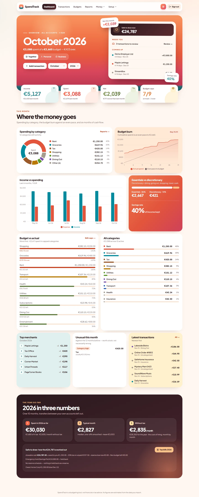
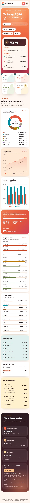
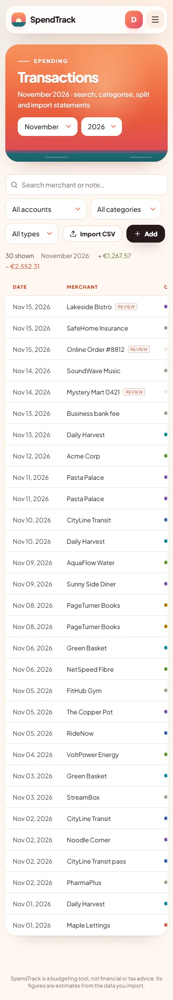
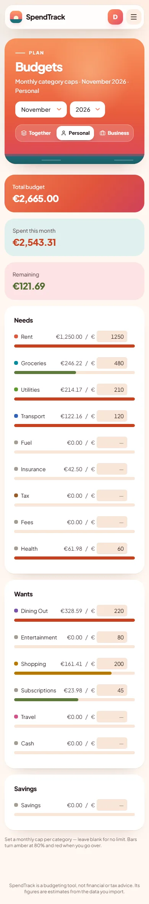
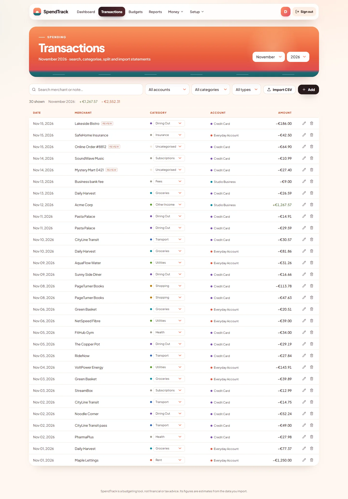

# SpendTrack

A local-first personal finance tracker. Import your bank statements, let the app categorise the rows, and see where the money goes: budgets, recurring bills, income, goals and net worth. It runs on your own machine in Docker, keeps everything in your own Postgres, and reads receipt photos with a **local vision model in Ollama**, so no statement or receipt has to leave the box.

## Why I built it

Banking apps show one bank each, and the aggregators that show all of them want your bank logins and your data on their servers. I wanted one place for several banks and cards in several currencies, fed by the statements the banks already give you, with numbers I could trust: every imported statement is checked against the totals the bank printed on it before a single row is written.

## What you get

| Area | What it does |
|---|---|
| **Dashboard** | Month at a glance: income, spent, net, pace against the month, category donut, budget-vs-actual bars, top merchants, 6-month trend, upcoming bills, an "unusual this month" list and a to-review inbox. Scope toggle **Together / Personal / Business**. |
| **Safe to draw** | One number: drawable cash (real statement balances) + invoices earned but not yet paid − a tax set-aside − an optional reserve − what is left of this month's budget. A missing balance is reported as missing, never guessed. |
| **Accounts & balances** | Bank, card, cash, savings and investment accounts in any currency. Real balances are the closing balance printed on a statement (or typed in), with fresh / stale / missing chips. An account can be **held back** (e.g. "VAT reserve") so it never counts as drawable. |
| **Transactions** | Month view with search and filters, inline categorising, **split** one charge across categories, an **accrual date** for a charge that belongs to another month, and file **attachments** (receipt photo, invoice PDF) stored in the database. |
| **Statement import** | Drop a PDF or a bank's own CSV export. The bank is detected from the file itself, the rows are parsed and **reconciled against the statement's printed totals** (or the running-balance chain for CSV exports), and you see the verdict before anything is written. Overlapping statements are de-duplicated. Example parsers: **Revolut** (PDF + CSV), **Wise** (PDF + CSV), **American Express** (PDF), **Trading 212** (CSV). Words that change with the statement's language (month names, column headers, credit markers) live in one table per language, so a statement downloaded in another language parses the same way. Any other CSV goes through a generic column mapper. |
| **Receipts** | Snap a receipt and a local vision model (default `qwen2.5vl:7b` in Ollama) reads vendor, date, amount and currency in two passes: one reads the loudest number, one transcribes every labelled amount and picks the payable one by rule. When the two disagree the draft says so. A receipt is always a draft you confirm. A **missing receipts** page lists business costs without a receipt or attachment. |
| **Categories & rules** | Categories grouped Needs / Wants / Savings / Income, with monthly caps and an "exclude from totals" flag for transfers. Ordered **rules** (payee, amount range, account, currency → category, display name, note, tags) with preview, apply-to-history and undo. Every manual categorisation also learns a merchant rule. |
| **Budgets** | Per-category monthly caps and a 50/30/20 overview. |
| **Recurring** | Subscriptions, rent, salary and invoices with cadence and end date; per-month totals; paid / due / missed status matched against imported rows; "log now"; and suggestions detected from your history. |
| **Income** | Received year to date, year-end projection from your recurring income rules (ended rules stop projecting), income by source and month, fixed outgoings. Synced dividends count as investment income. |
| **Goals** | Savings goals tracked from an account's balance, the reserve plan, or a manual figure. |
| **Investments** | Read-only portfolio tracking for **Trading 212** (public API) and **Interactive Brokers** (Flex Web Service), plus holdings you add by hand: value, unrealised P/L, allocation, holdings table, value over time, dividends, trades and deposits/withdrawals. Credentials live only in `.env`; the sync never places orders. Without credentials the page works with manual holdings and says "not connected". |
| **Net worth** | Cash + investment accounts + broker portfolios + other assets − cards and debts, monthly snapshots and CSV export. A broker connection linked to an investment account replaces that account's balance, so a portfolio is never counted twice. |
| **Reports** | 18-month income/expense trend, category breakdown and a cash-flow Sankey (income → groups → categories), with synced dividends as their own income source. |
| **Multi-currency** | Every row keeps its own currency; totals convert to EUR with ECB reference rates for the transaction date (static fallback table). A currency with no rate is refused, never counted 1:1. |

## Local-first and private

- **Your data stays in your Postgres**, in a Docker volume on your machine. There is no cloud service, no telemetry and no bank-login aggregator.
- **Broker sync is opt-in.** Only when you set Trading 212 or IBKR credentials does the app call those brokers' read-only APIs, and only when you press **Sync now**. The credentials are read from the environment and never written to the database.
- **Receipts are read locally.** The parser sidecar calls Ollama on the host (`host.docker.internal:11434`). An optional OpenRouter engine exists for machines without a GPU; it is off unless you set `SPENDTRACK_RECEIPT_ENGINE=openrouter`, and then the image does leave the machine.
- **Every port binds to `127.0.0.1`.** The app, the parser and Postgres are not reachable from your network.
- **Hardened containers**: read-only root filesystems, all capabilities dropped, `no-new-privileges`, memory/CPU/PID limits, a least-privilege database role for the app (no `CREATE` on the schema).
- **Auth**: single-user custom JWT (jose, HS256, httpOnly cookie), bcrypt cost 12, a durable account lockout after 5 failures, timing-equal answers for unknown emails, CSRF origin checks, a host allowlist against DNS rebinding, and rate limits on every API route.
- **The parser sidecar fails closed**: every upload must carry a shared `PARSER_TOKEN`, zip bombs are refused, and the image contains only the parser files and a hash-pinned virtualenv.

## Stack

| Layer | Tech |
|---|---|
| App | Next.js 16 (App Router), React 19, TypeScript, Tailwind CSS 4, Recharts |
| Data | PostgreSQL 16, Prisma 7 with the `@prisma/adapter-pg` driver adapter |
| Auth | Custom JWT with `jose` + `bcryptjs`, sessions stored hashed |
| Parsers | Python 3.12, FastAPI, markitdown + pdfplumber (sidecar container) |
| Receipts | Ollama vision model (default `qwen2.5vl:7b`) |
| Tests | Vitest (564 tests: maths, API contracts, auth, broker mapping) and pytest (68 tests: the real parsers on synthetic statements) |

## Quick start

Requirements: Docker with Compose v2. For receipt reading, [Ollama](https://ollama.com) on the host with a vision model:

```bash
ollama pull qwen2.5vl:7b
```

Then:

```bash
# after cloning this repository:
cd spendtrack
cp .env.example .env      # replace every change-me value (openssl rand -hex 32)
docker compose up -d --build
```

Open <http://127.0.0.1:3000> and sign in with `SEED_ADMIN_EMAIL` / `SEED_ADMIN_PASSWORD` from your `.env`.

What happens on `up`: Postgres starts and creates the least-privilege `spendtrack_app` role; a one-shot `spendtrack-init` container applies the migrations and seeds your user plus a set of default categories (no transactions, no budgets); then the parser and the app start. Re-running `up` is safe: the init step is idempotent.

First steps in the app: create your accounts on **Accounts**, then **Transactions → Import** a statement. Set monthly caps on **Categories** or **Budgets** when you know your numbers.

### Configuration

All settings live in `.env`; `.env.example` documents each one.

| Variable | Meaning |
|---|---|
| `POSTGRES_PASSWORD`, `SPENDTRACK_APP_DB_PASSWORD` | Superuser and runtime-role passwords (required) |
| `JWT_SECRET` | Session signing key, 32+ characters (required) |
| `SEED_ADMIN_EMAIL`, `SEED_ADMIN_PASSWORD` | Your login, created on first start (required, password 12+ characters) |
| `PARSER_TOKEN` | Shared secret between app and parser (required) |
| `SPENDTRACK_VLM_MODEL`, `SPENDTRACK_OLLAMA_URL` | Receipt model and where Ollama runs |
| `SPENDTRACK_PORT`, `SPENDTRACK_PARSER_PORT`, `SPENDTRACK_DB_PORT` | Loopback ports (defaults 3000 / 18000 / 15432) |
| `SAFE_TO_DRAW_TAX_RATE`, `SAFE_TO_DRAW_MONTHLY_BUDGET`, `SAFE_TO_DRAW_SINCE` | The safe-to-draw plan (defaults 0.25 / 2000 / 2000-01-01) |
| `CARDHOLDER_NAME` | Your surname as printed on card statements, so a line that is only your name never wins over the real merchant when overlapping statements are merged |
| `TRADING212_API_KEY`, `TRADING212_API_SECRET`, `TRADING212_ENV` | Optional Trading 212 connection (read-only key; `demo` = practice account) |
| `IBKR_FLEX_TOKEN`, `IBKR_FLEX_QUERY_ID` | Optional Interactive Brokers connection (Flex Web Service token + Activity Flex query id) |
| `BROKER_SYNC_USER_EMAIL` | On an install with several users: the only user allowed to run the broker sync |

### Investments

1. **Trading 212**: in the app, *Settings → API*, generate a key with read-only permissions (account data, portfolio, history of orders, dividends and transactions). Put the key and its secret in `TRADING212_API_KEY` / `TRADING212_API_SECRET`.
2. **Interactive Brokers**: in Client Portal, *Performance & Reports → Flex Queries*, create an **Activity Flex Query** in XML with the sections *Account Information*, *Cash Report*, *Open Positions*, *Trades*, *Cash Transactions* and, for the value history, *Net Asset Value (Equity Summary in Base)*. Enable the *Flex Web Service* to get a token. Put both in `IBKR_FLEX_TOKEN` / `IBKR_FLEX_QUERY_ID`. Flex reports are end-of-day.
3. `docker compose up -d` again (the app reads the variables at start), open **Money → Investments** and press **Sync now**.

The sync is rate limited (two runs a minute) to stay inside the brokers' own limits; a broker that fails or hits its limit part-way keeps what it read and shows the reason, and never blocks the other one.

**Counted once.** Two things could double count, and neither does:

- *Net worth*: if you also keep an **Investment** account with typed balances for the same broker, pick it under "Replaces account" on the broker's card. Net worth then uses the synced value instead of that balance, not both.
- *Income*: if you import Trading 212 statement CSVs, their dividends are already income rows ("Dividend <ticker>"). A synced dividend is only added to income when no imported dividend row matches it (same ≈EUR amount, within 3 days, on the linked account when there is one). The imported row wins because it is part of your reviewed, reconciled ledger. Deposits, withdrawals, buys and sells from a statement stay **Transfers**, outside every total.

### Development

```bash
npm install --include=dev
npx prisma generate
docker compose up -d spendtrack-postgres spendtrack-parser spendtrack-init
PARSER_URL=http://127.0.0.1:18000 npm run dev      # http://localhost:3000

npm run typecheck        # tsc --noEmit
npm run lint             # eslint
npm test                 # vitest
npm run test:parser      # pytest tests/parser (needs: pip install -r scripts/parser-requirements.txt pytest)
npm run test:live        # loads every page of the running app with a temporary session
npm run fx:update        # pull today's ECB rates into the database
```

## Screenshots

All figures, merchants and names below are fictional demo data (`scripts/seed-demo.ts`).

**Dashboard** — the month in one sentence, safe-to-draw panel, budget burn against an even pace, category donut, six-month cash flow, budget caps and the year so far.



<p>
  
  
  
</p>

**Transactions**



Every other page, desktop (1440 px) and phone (390 px):

| Page | Screenshots |
|---|---|
| **Budgets** | [desktop](docs/screenshots/budgets-desktop.webp) · [phone](docs/screenshots/budgets-phone.webp) |
| **Reports** | [desktop](docs/screenshots/reports-desktop.webp) · [phone](docs/screenshots/reports-phone.webp) |
| **Accounts** | [desktop](docs/screenshots/accounts-desktop.webp) · [phone](docs/screenshots/accounts-phone.webp) |
| **Net worth** | [desktop](docs/screenshots/net-worth-desktop.webp) · [phone](docs/screenshots/net-worth-phone.webp) |
| **Income** | [desktop](docs/screenshots/income-desktop.webp) · [phone](docs/screenshots/income-phone.webp) |
| **Recurring bills** | [desktop](docs/screenshots/recurring-desktop.webp) · [phone](docs/screenshots/recurring-phone.webp) |
| **Goals** | [desktop](docs/screenshots/goals-desktop.webp) · [phone](docs/screenshots/goals-phone.webp) |
| **Balances** | [desktop](docs/screenshots/balances-desktop.webp) · [phone](docs/screenshots/balances-phone.webp) |
| **Missing receipts** | [desktop](docs/screenshots/receipts-desktop.webp) · [phone](docs/screenshots/receipts-phone.webp) |
| **Categories** | [desktop](docs/screenshots/categories-desktop.webp) · [phone](docs/screenshots/categories-phone.webp) |
| **Rules** | [desktop](docs/screenshots/rules-desktop.webp) · [phone](docs/screenshots/rules-phone.webp) |
| **Sign-in** | [desktop](docs/screenshots/login-desktop.webp) · [phone](docs/screenshots/login-phone.webp) |

To load the same demo data into a fresh install (it **replaces** the seeded user's data):

```bash
DEMO_SEED_CONFIRM=1 npx tsx scripts/seed-demo.ts   # after npm run db:seed, with DATABASE_URL + SEED_ADMIN_EMAIL set
```

## Adding a bank

Each parser lives in `scripts/parse_statements.py` and returns rows plus the statement's own printed totals; detection lives in `scripts/bank_detect.py` and reads the issuer from the letterhead only (a bank named in the body is a payee, not the issuer). Words that depend on the statement's language belong in `scripts/l10n_keywords.py` (the app's CSV importer has the same table in `src/lib/l10n-keywords.ts`), not in the parser. Add a synthetic fixture under `tests/parser/fixtures/` and a test that a sabotaged copy of it is caught, then wire the format into `scripts/statement_service.py`.

## Honest limits

- Single user. There is one login and no sharing.
- Parsers exist for the banks listed above; other banks go through the generic CSV mapper, which cannot reconcile against printed totals.
- The safe-to-draw tile models one simple plan (tax share, monthly budget, optional reserve steps). Reserve steps are rows in the `reserve_steps` table; there is no editor for them yet.
- Exchange rates are ECB reference rates, good for budgets and trends, not for accounting-exact figures.

## Disclaimer

SpendTrack is a budgeting tool, not financial or tax advice. Its figures (tax set-aside, safe to draw, projections, converted totals) are estimates from the data you import and the settings you choose; check anything that matters with a qualified adviser. The demo data in the screenshots and in `scripts/seed-demo.ts` is fictional.

## License

[MIT](LICENSE)
